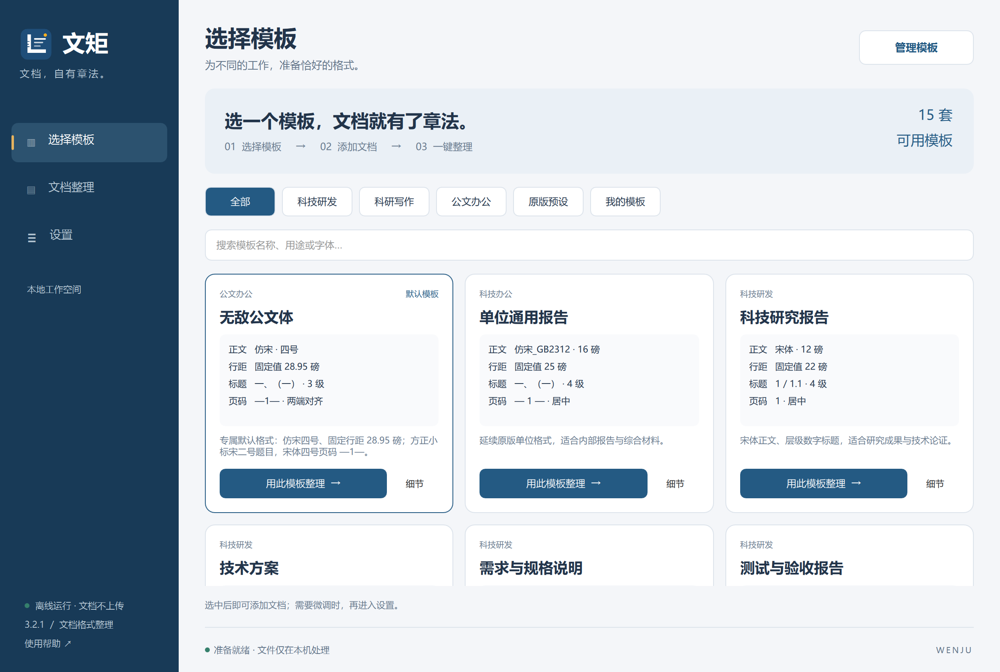
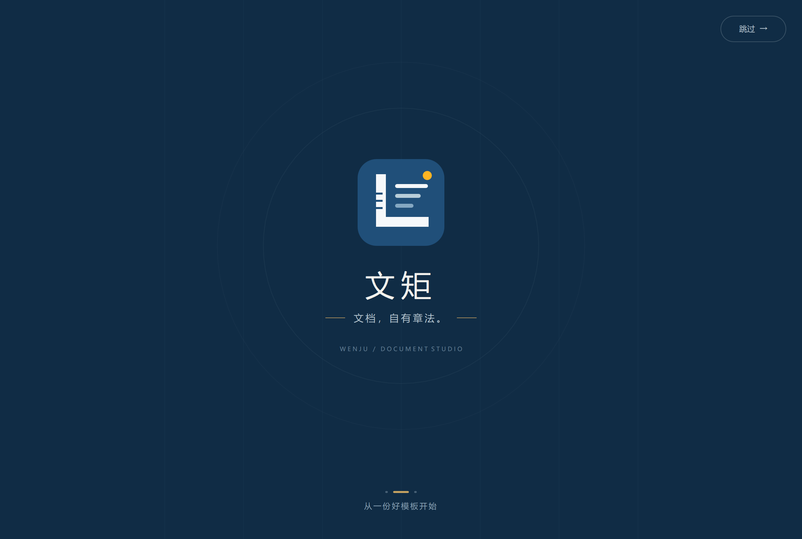
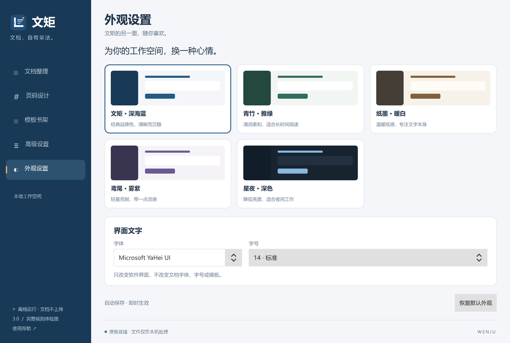
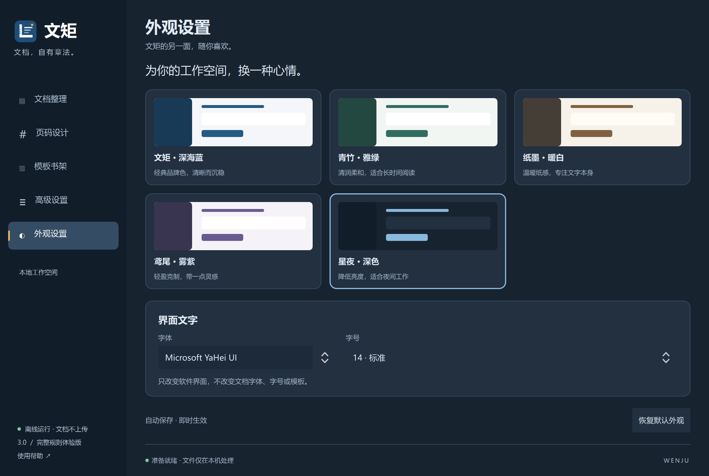

# 文矩 WenJu

**文档，自有章法。** 离线 Word 文档格式整理工具，Qt Quick / QML 桌面界面与 Python 文档处理引擎。

## 3.3.0 功能

- 115 套场景模板（含 10 套红头文件），按工作用途提供内容提示；同类文种共享规范版式，可进一步编辑。
- 红头支持机关名称、发文字号、签发人和红线；填写机关名称后使用。不包含印章、版记或完整公文标准校验。
- 模板分类、搜索、9 张卡片分页；卡片悬停、按钮按压、页面淡入，可关闭动效。
- 程序目录只读时自动回退用户数据目录；`--safe-render` 提供软件渲染与低动效模式。
- [麒麟免安装部署与验收方案](docs/跨平台部署.md)：提供银河麒麟 V10 ARM64 与 x86_64 便携包及 `launcher/start-kylin.sh`。运行库按 glibc 2.28 兼容基线准备；飞腾/鲲鹏真机性能仍待复核。


- 新增默认模板「无敌公文体」：仿宋四号，固定行距 28.95 磅，页边距上 3.7 / 下 3.5 / 左 2.8 / 右 2.6 cm；方正小标宋简体二号题目，黑体三号密级，宋体四号页码 —1—。
- 公文题目和密级独立配置；仅识别已有密级行。正文与页码均使用两端对齐，所有页相同。

- 默认进入模板首页：选模板 → 导入文档并整理 → 设置。模板卡直接显示正文、行距、标题和页码规则，再展示用途。
- 精致的品牌开场：标尺成形、文字归位、金点落位；约两秒，可跳过，也可在设置中关闭。
- 设置统一收纳格式规则、页码设计和外观；模板管理集中提供导入、导出、另存和识别。

- 深海蓝、青竹绿、纸墨暖白、鸢尾紫、星夜深色，五套即时切换的界面皮肤。
- 可选界面字体及 12 / 14 / 16 / 18 四档字号；偏好与文档排版规则独立保存。
- 115 套预设，包含科技研发、科研写作、公文办公及两套原版预设。
- 245 项可编辑格式设置：页面、字体、字体嵌入、正文、九级标题、图表题注、表格、封面、页码、标点、输出。
- 模板编辑、另存、删除、JSON / ZIP 导入、单套及整库导出；从排版样本识别模板。
- 页码左右字符、整组字体字号、字间距、对齐、起始位置与示意预览。
- 后台独立进程、批量任务、规则快照、原文档保护、应用内报告与环境检测。









## Windows 便携运行

从 Releases 下载完整 Windows 便携包，解压到当前用户可写的目录，双击 **文矩.exe**。该包面向 Windows 10/11。Windows 7 SP1 x64 使用单独的便携包，见 [Windows 7 兼容说明](docs/Windows7兼容.md)。

EXE 是带文矩图标、无需管理员权限的启动入口。请保留旁边的 `runtime`、`core` 和应用文件，不要单独移动 EXE；不需要另装 Python。

`工作数据` 保存个人模板、当前方案、外观偏好与输出文件。该目录不包含在公开源码或发布包中。请自行备份。

DOCX 整理不需要 Office。DOC / WPS / RTF 转换使用电脑上已安装的 Word、WPS 或 LibreOffice，未安装时会提示失败。

## 源码开发

Windows 已验证的组合为 Python 3.13 和 PySide6 Essentials 6.10.3：

```powershell
python -m venv .venv
.venv\Scripts\python.exe -m pip install -r requirements-windows.txt
.venv\Scripts\python.exe app.py
```

编译 EXE 启动入口（Windows 系统自带的 .NET Framework C# 编译器）：

```powershell
powershell -ExecutionPolicy Bypass -File launcher/build.ps1
```

`runtime` 不进入 Git。便携包构建需先准备 Python Windows embeddable runtime，以及相应 PySide6 Essentials / Shiboken6 运行库。`launcher/package.py` 将已准备好的运行环境和应用组成发布包。

## 验证

```powershell
python test_footer.py
python test_presets.py
python test_appearance.py
$env:WENJU_DATA_DIR = Join-Path $env:TEMP ('wenju-test-' + [guid]::NewGuid().ToString('N'))
python app.py --smoke
python app.py --capture-themes
```

测试涵盖格式字段、模板导入导出、非法值、Word XML 输出、界面交互、后台识别和 UI 偏好持久化。

## 文件结构

- `Main.qml`、`Advanced.qml`、`AppearancePage.qml`：工作台、高级规则与外观设置。
- `app.py`：界面桥接、任务调度与报告。
- `appearance.py`：界面皮肤、字体和字号偏好。
- `preset_store.py`：完整规则、校验和模板存取。
- `worker.py`、`core/`：文档处理、字体嵌入和样本识别。
- `launcher/`：Windows EXE 图标、源码及构建脚本。

## 适用范围

场景预设不是国标符合性认证；正式公文、投稿材料仍应按单位或期刊要求复核。
页码预览是样式示意，实际分页与域刷新请用 Word / WPS 检查。
银河麒麟 V10 使用单独的 ARM64 / x86_64 便携包，不能换用 Windows 运行库。正式公文、投稿材料和真机图形性能仍需按目标环境复核。

PySide6、Qt、Python 等第三方组件遵循各自许可，便携包内保留相应许可文件。
