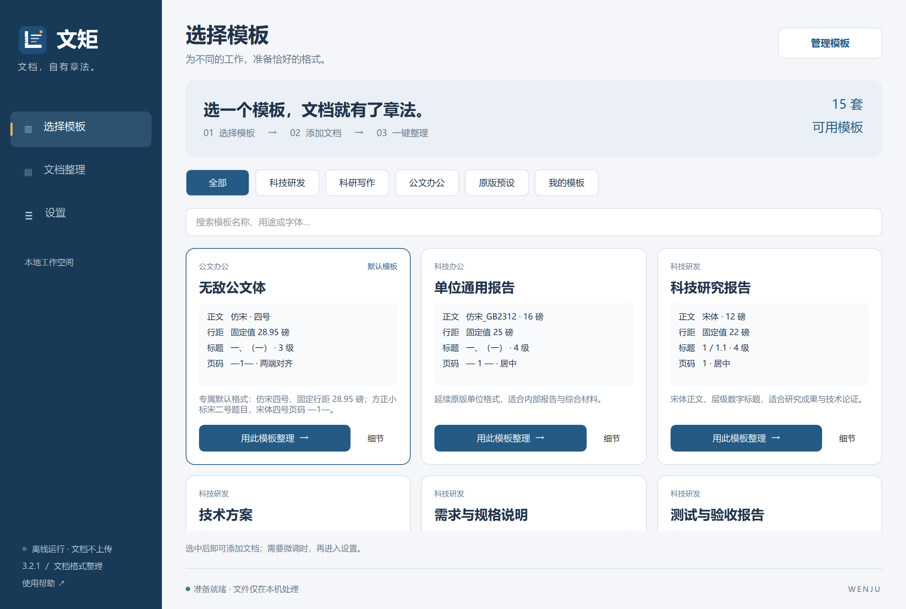

# 文矩 WenJu

文矩是一款离线运行的文档排版工具。用模板批量整理 Word 文档、从成熟样文提取预设、把 Markdown 排成 Word，或检查现有文档与模板有哪些差异。文档在本机处理。

[下载安装包](https://github.com/bhuyuqingguo/wenju/releases) · [使用说明](使用说明.txt) · [反馈问题](https://github.com/bhuyuqingguo/wenju/issues)



## 下载与启动

从 [GitHub Releases](https://github.com/bhuyuqingguo/wenju/releases) 选择已发布的完整便携包。本文档介绍仓库当前源码中的 3.4.8 功能，下载版本以 Release 页面为准。

| 系统 | 选择的包 | 解压后启动 |
| --- | --- | --- |
| Windows 10 / 11 64 位 | Windows x64 | 双击 `打开文矩.exe` |
| Windows 7 SP1 64 位 | Windows 7 x64 测试版 | 双击 `打开文矩.exe`，系统条件见 [Win7 兼容说明](docs/Windows7兼容.md) |
| 银河麒麟 V10，飞腾 / 鲲鹏 | ARM64 | 运行 `sh ./打开文矩.sh` |
| 银河麒麟 V10，Intel / AMD / 兆芯 | x86_64 | 运行 `sh ./打开文矩.sh` |

完整解压到可写目录，保留顶层的启动入口和同级的 `文矩` 文件夹。旧版 Windows 包若只有一个文件夹，进入该目录双击 `文矩.exe`。Windows 版无需 .NET 或管理员权限。DOCX 整理无需 Office。旧 `.doc`、`.wps`、`.rtf` 需要本机 Word、WPS 或 LibreOffice 中转，具体取决于系统和文件类型。

个人模板、当前方案、外观偏好和教学练习保存在 `文矩/工作数据`。程序目录不可写时，会改用当前用户的数据目录。搬迁便携版时，请保留工作数据和自备字体。

## 第一次使用

1. **选模板**。从模板书架按用途筛选或搜索。点「用此模板整理」进入工作台，模板卡可直接查看正文、标题、行距和页码规则。
2. **导入与处理**。拖入文档，或点「选择文档」。用「开始整理」生成副本。对现有 DOCX 只做检查时，点「校核格式」。
3. **查看和复用**。核对输出文件及报告。需要反复使用自己的规则时，另存到「我的模板」。

左下角「使用教学」提供文字步骤和离线普通话语音。「从样文创建模板」「Markdown 排版」「排版校核」配有练习案例。点「开始语音练习」，可一边听一边操作副本。麒麟播放语音需要系统提供 `paplay`、`pw-play` 或 `aplay`。

## 能做什么

- **按模板批量整理**。内置 115 套场景预设，涵盖公文、红头文件、科技研发和科研写作。可以编辑页面、字体、标题编号、段落、题注、表格和页码。默认模板为「无敌公文体」，字体嵌入默认关闭，必要时可在「设置 → 格式规则 → 字体嵌入」开启。
- **用样文创建个人模板**。在「管理模板」选择 DOCX 或 DOTX 样文，核对已读取、推断、未识别及冲突的项目，编辑后独立保存。当前工作方案会保留。
- **Markdown 排版**。支持 `.md` 和 `.markdown` 的结构预览，按模板导出 Word。可识别标题、强调、链接、嵌套列表、引用、代码块、表格和本地图片，缺图会给出提示。
- **DOCX 格式校核**。按模板检查页边距、字体字号、行距、对齐、缩进和自动页码字段。报告列出所在位置、实际值、要求值及需人工复核的内容，源文件保持不变。
- **转换、合稿和界面偏好**。支持文矩与 Word 转换、剪贴板预览和多份文档合稿。可调界面字体、字号、皮肤和动效。

Word 或 WPS 中的实际分页、字体替换和复杂图形仍需要复核。场景模板和校核报告用于日常工作，不提供正式公文国标符合性认证。

## 模板字体与离线字体包

选好模板后打开「模板字体」，查看本机缺哪些字体。联网时可下载 Noto CJK 的简体中文黑体、宋体（SIL OFL 1.1）。点击「应用开源替代」会修改当前方案的对应字体规则，之后可另存为个人模板。方正等授权字体请从权利人取得；开源替代不等同于公文指定的原字体。

点击「导出字体包」，在断网电脑的「模板字体」中直接导入 ZIP。字体包只包含文矩提供的开源字体及许可证，不转存系统或商业字体；如需携带个人模板，请在「管理模板」另外导出。字体下载和导入不会打开 DOCX 字体嵌入。Windows 10/11 与麒麟可选「安装到当前用户」，再重开 Word/WPS；Win7 可在文矩中预览，Word/WPS 仍需系统具备该字体。

## 离线增量升级

**3.4.7 起可在界面中升级。** 打开「设置 → 离线升级」，直接选择与现有系统和架构对应的升级 ZIP。核对当前版本、目标版本和待更新文件后，点「退出并升级」。文矩会应用补丁、重开并显示结果。

累计补丁覆盖发行清单收录的 3.4.5 起各旧版，只带实际变化的文件。3.4.5 和 3.4.6 还没有图形化入口，可先换用带该入口的完整便携包，并把旧版 `文矩/工作数据` 复制到新版。

## 开发与发版

界面使用 Qt Quick / QML，文档处理使用 Python。直接运行源码时，Windows 可使用 Python 3.13 和 `requirements-windows.txt` 中的 PySide6 Essentials：

```powershell
python -m venv .venv
.venv\Scripts\python.exe -m pip install -r requirements-windows.txt
.venv\Scripts\python.exe app.py
```

- `app.py`、`Main.qml` 和 `ui/` 提供界面和任务入口，`worker.py` 与 `core/` 处理文档，`preset_store.py` 管理预设。
- `launcher/build.ps1` 构建原生 Windows 入口，构建机需 Visual Studio C++ Build Tools 和 Windows SDK。便携包的运行库单独准备，不纳入 Git。构建与平台限制见 [跨平台部署说明](docs/跨平台部署.md)。
- `launcher/package_update.py` 根据保留的完整归档生成累计补丁。请归档自 3.4.5 起每个发版的完整包，避免漏掉旧版升级路径。
- 发版验收在 Windows 构建机运行一次 `python launcher/verify_update.py --target 3.4.8`，请把版本替换为本次目标。脚本自动检查四个平台各旧版的文件和校验值，再在临时目录实际执行一次 Windows x64 升级。文件校验与 Win7、麒麟实机启动验证分别记录。

新增用户功能时请同步更新内置文字和离线语音，参见 [项目协作规则](AGENTS.md)。第三方组件遵循各自许可，便携包保留有关许可文件。
