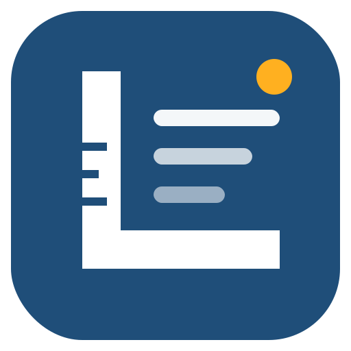

# 归档试点会议记录

## 本次会议结论

先选择**三个常用目录**试点，同时保留原始文件副本。

1. 收集现有文件。
   - 确认文件名和版本号。
   - 将图片与说明放在同一目录。
2. 抽查两份材料并登记问题。

> 先完成试点复核，再扩大范围。

| 检查项 | 状态 |
| --- | --- |
| 文件归类 | 已完成 |
| 目录复核 | 待确认 |

~~~text
归档试点/
  会议记录/
  审核材料/
~~~
